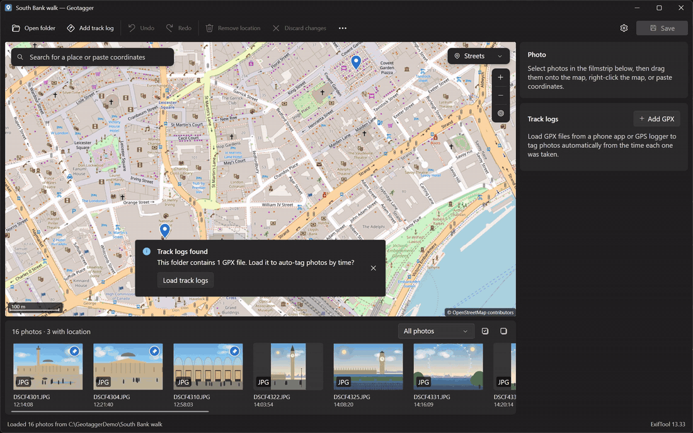
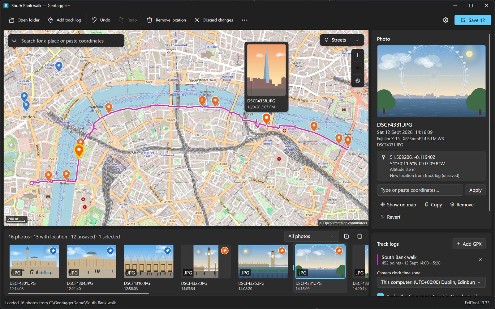
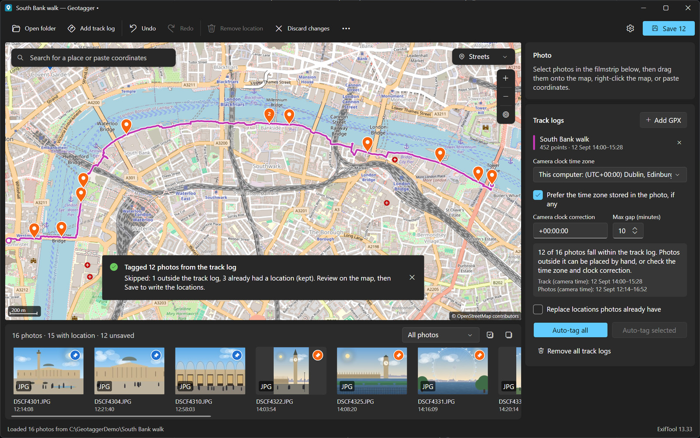
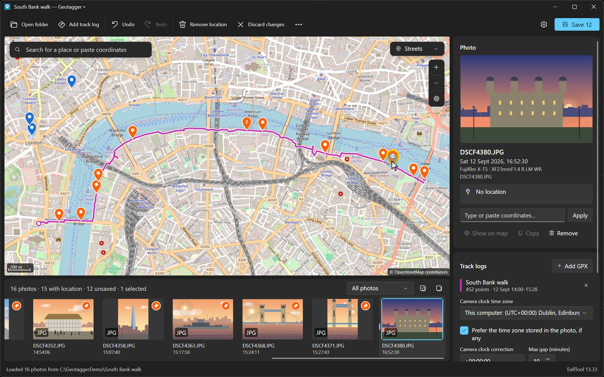
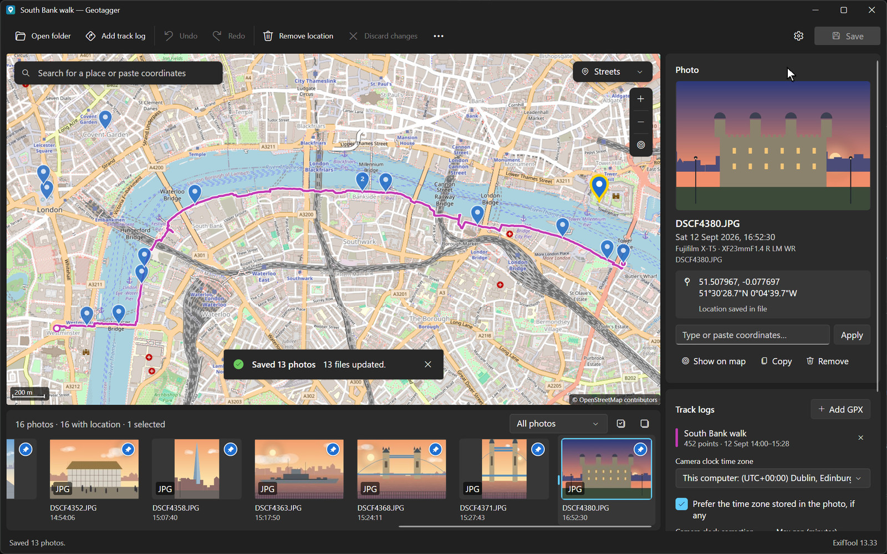
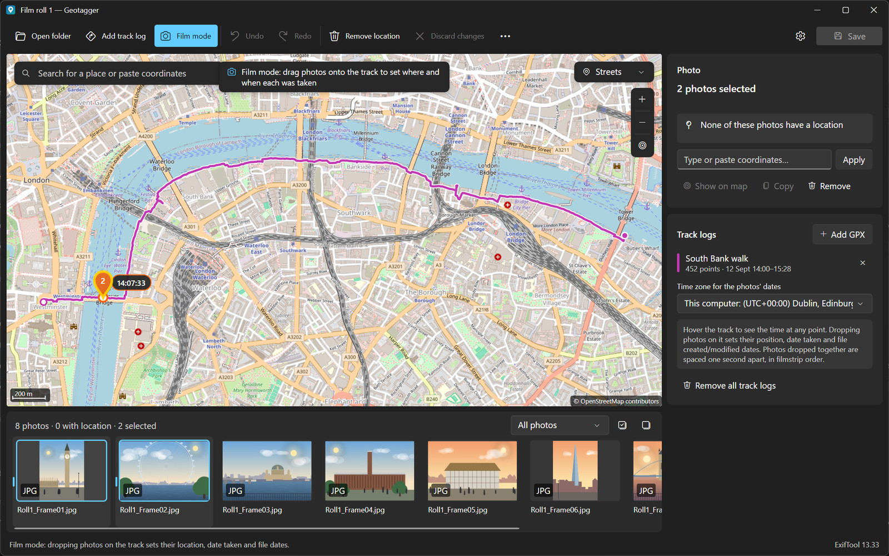

# Geotagger

[](https://github.com/alex-mcdermott/Image-GeoTagger-GUI/actions/workflows/ci.yml)

A desktop app for adding GPS locations to photos and videos: camera RAW files, JPEG/HEIC/TIFF and MOV/MP4. Place them on a map the way Lightroom Classic's Map module works, match them to GPX track logs by time, or, for film photographers, set where *and when* each frame was taken from a track you recorded on your phone. It runs on Windows and macOS, uses [ExifTool](https://exiftool.org) under the hood, and has a Windows 11 (Fluent) look.

[](docs/demo.mp4)

<sub>45-second demo: load a GPX track, auto-tag the photos, drop a photo the track missed onto the map, fine-tune its pin and save. [Watch the full-quality video (MP4)](docs/demo.mp4).</sub>

## Features

- **Photos and videos.** Camera RAW (ORF, CR2/CR3, NEF, ARW, RAF, RW2, DNG and more), JPEG, HEIC, TIFF, PNG, and MOV/MP4/M4V/3GP videos. RAW+JPEG pairs are treated as one photo, and existing XMP sidecars are detected.
- **Place on a map.** Drag thumbnails onto the map, right-click to *Place selected photos here*, drag pins to move them, paste coordinates in almost any format (decimal, degrees-minutes-seconds, Google Maps or OpenStreetMap links), or search for a place.
- **Auto-tag from GPX track logs.** Capture times are matched to the track, interpolating between fixes. You can set the camera's time zone (daylight saving is handled), a clock correction and the maximum time gap. A summary shows how many photos fall inside the track, and the time ranges to compare when they don't.
- **Film mode.** Record a GPX track on your phone while shooting film, then drag your scans onto the route. Each frame gets the position *and* the time of that point on the track, written as the date taken and the file's created/modified dates.
- **Home location.** Save where you live once (it stays on your computer only), then tag photos taken at home with one click or Ctrl/⌘+H.
- **Review before writing.** Unsaved changes show as orange pins and badges, with full undo/redo, until you press **Save**.
- **Safe writing:**
  - Locations go into the files, into XMP sidecars, or both.
  - File modification dates are kept, and you can choose to keep `_original` backups.
  - Every saved file is read back to verify the location (and, in film mode, the date) landed.
- **Map:** Streets, Satellite, Hybrid, Terrain and Dark styles. Pins cluster when zoomed out, and hovering a pin shows a preview.
- **Fast thumbnails.** Embedded previews give correctly rotated thumbnails without decoding RAWs. Video thumbnails use a frame grabbed with [ffmpeg](https://ffmpeg.org) when it's installed.
- Follows the system light/dark theme.

## Download

Get the latest build from the [Releases page](https://github.com/alex-mcdermott/Image-GeoTagger-GUI/releases):

| Platform | File | Notes |
| --- | --- | --- |
| Windows 10/11 (x64) | `Geotagger-x.y.z-win-x64.zip` | Unzip and run `Geotagger.exe`. ExifTool is included. |
| macOS (Apple silicon) | `Geotagger-x.y.z-osx-arm64.zip` | Unzip and move `Geotagger.app` to Applications (or `~/Applications` if you aren't an administrator). ExifTool is included. |
| macOS (Intel) | `Geotagger-x.y.z-osx-x64.zip` | As above. |

The macOS app is not notarised. The first time, right-click it and choose **Open**, or run `xattr -dr com.apple.quarantine /Applications/Geotagger.app` (using the folder you installed it in).

If ExifTool isn't bundled or installed, Geotagger offers to download the latest version from exiftool.org, or you can point it at an existing copy in **Settings**. ffmpeg is optional and only used for video thumbnails (`winget install ffmpeg` on Windows, `brew install ffmpeg` on macOS).

## Using it

<table>
  <tr>
    <td width="50%"></td>
    <td width="50%"></td>
  </tr>
  <tr>
    <td align="center"><b>Browse:</b> select a photo for its preview and details, and hover pins for previews</td>
    <td align="center"><b>Auto-tag:</b> photos are matched to the GPX track by time</td>
  </tr>
  <tr>
    <td width="50%"></td>
    <td width="50%"></td>
  </tr>
  <tr>
    <td align="center"><b>Drag and drop:</b> place photos the track missed directly on the map</td>
    <td align="center"><b>Save:</b> locations are written to the files and read back to verify</td>
  </tr>
</table>

<sub>The screenshots and video use demo illustrations and a demo GPX track generated by [docs/demo/make_demo.py](docs/demo/make_demo.py).</sub>

### Tagging photos and videos

1. **Open folder** (Ctrl/⌘+O), or drop a folder onto the window. GPX files in the folder are offered automatically.
2. Select photos or videos in the filmstrip (Ctrl/⌘ and Shift for multiple), then do one of the following:
   - drag them onto the map;
   - right-click the map → *Place selected photos here*;
   - paste coordinates (Ctrl/⌘+V) or type them in the Photo panel;
   - search for a place, then *Place selected photos at the search pin*;
   - press **Home** (Ctrl/⌘+H) to use your home location.
3. With track logs, choose **Add GPX**, check the camera's time zone, and click **Auto-tag all**. If nothing matches, compare the *Track* and *Photos* times shown in the panel and adjust the time zone or the clock correction (for example `+00:01:30` if the camera clock was 90 seconds slow).
4. Check the orange pins, then **Save** (Ctrl/⌘+S).

### Film mode



Film cameras don't record when or where a frame was taken, but your phone can. Record a GPX track (for example with Open GPX Tracker, Strava or Gaia GPS) while you shoot, then:

1. Open the folder of scans and turn on **Film mode** in the toolbar (Ctrl/⌘+M).
2. **Add GPX** to load the track. Hover over the route to see the time at any point.
3. Drag frames from the filmstrip onto the route where you took them:
   - Pins snap to the track, and drops off the route are ignored.
   - Dragging a pin along the route changes its time, and right-click → *Place here* also works.
   - Several frames dropped together are spaced one second apart, in filmstrip order, so they sort correctly by date.
4. Check the *Time zone for the photos' dates* (it defaults to this computer's zone and handles daylight saving), then **Save**.

For each frame this writes:
- the GPS position, altitude and GPS time from the track;
- `DateTimeOriginal` with `OffsetTimeOriginal`;
- the file's modified date, plus the created date on Windows (and on macOS when Apple's developer tools are installed).

In sidecar mode the dates go into the `.xmp` (`XMP-exif:DateTimeOriginal`, `XMP-photoshop:DateCreated`) and the RAW file's contents aren't touched. For videos, the QuickTime creation dates are set too (see below).

### Home location

Lots of photos taken at home never get GPS. Set your home once and tag them in one go:

- **Settings → Home location:** paste coordinates or a map link. Or right-click the map and choose **Set home location here**.
- A green house pin marks it on the map. Drop photos on it, select photos and press **Home** in the Photo panel or **Ctrl/⌘+H**, or right-click → *Place selected photos at home*.
- **Tip:** *Select photos without a location* (in the ⋯ menu) followed by Ctrl/⌘+H tags a whole folder of untagged home photos.

Your home location is stored only in your personal settings file (`%APPDATA%\Geotagger\settings.json` on Windows, `~/.config/Geotagger/settings.json` on macOS). It is never written into the project, the repository or anywhere else, apart from the photos you choose to tag with it.

### Shortcuts

| Shortcut | Action |
| --- | --- |
| Ctrl/⌘+O | Open folder |
| Ctrl/⌘+G | Add GPX track log |
| Ctrl/⌘+S | Save |
| Ctrl/⌘+Z / Ctrl/⌘+Y | Undo / redo |
| Ctrl/⌘+C / Ctrl/⌘+V | Copy / paste coordinates between photos |
| Ctrl/⌘+H | Place selected photos at home |
| Ctrl/⌘+M | Toggle film mode |
| Ctrl/⌘+A, Esc | Select all / none |
| Ctrl/⌘+F | Search the map |
| Ctrl/⌘+, | Settings |
| F5 | Reload folder |
| Shift+drag on map | Box-select pins |
| Double-click map | Zoom in |

### What gets written

| Setting | RAW files | JPEG/HEIC/TIFF | Videos (MOV/MP4) | XMP sidecars |
| --- | --- | --- | --- | --- |
| *Write into the photo files* (default) | EXIF GPS tags | EXIF GPS tags | QuickTime + XMP GPS | Existing sidecars updated |
| *Write XMP sidecars* | untouched | EXIF GPS tags | QuickTime + XMP GPS | Created or updated (`IMG_1234.xmp`) |
| *Both* | EXIF GPS tags | EXIF GPS tags | QuickTime + XMP GPS | Created or updated |

**Photos.** The tags written are `GPSLatitude`/`GPSLongitude` with their `Ref` tags, plus `GPSAltitude` when the track has elevation and `GPSDateStamp`/`GPSTimeStamp` for track-log matches. Sidecars get the equivalent `XMP-exif` tags, and other sidecar content (Lightroom edits, labels and so on) is preserved.

**Videos.** Apps read video locations from different places, so Geotagger writes all the common ones:

| Location | Read by |
| --- | --- |
| `Keys:GPSCoordinates` (`com.apple.quicktime.location.ISO6709`) | Apple Photos, macOS, iOS |
| `UserData:GPSCoordinates` (`©xyz`) | Google Photos, Android, Windows |
| `XMP-exif:GPSLatitude`/`GPSLongitude`/`GPSAltitude` | Lightroom, Bridge, Premiere |
| The camera's embedded EXIF GPS block, when it has one (e.g. Fujifilm) | Camera-maker software |

Nikon's own GPS block can't be rewritten; Geotagger reads its own tags first, so the new location still takes effect. In film mode, the QuickTime creation dates (stored as UTC, as the format requires), `Keys:CreationDate`, `XMP-exif:DateTimeOriginal` and the file dates are set as well.

Image and video data are never re-encoded: ExifTool rewrites only the metadata.

## Building from source

Requires the [.NET 10 SDK](https://dotnet.microsoft.com/download).

```sh
dotnet run --project src/Geotagger            # run the app
dotnet run --project src/Geotagger -- "D:\Photos\Trip" track.gpx   # open a folder (and GPX) directly
dotnet test                                   # unit, ExifTool integration and headless UI tests
```

The integration tests need `exiftool` on the PATH (or in a standard install location); video tests also use `ffmpeg` to make a test clip. Opt-in tests are controlled by environment variables:
- `GEOTAGGER_SAMPLE_RAW=path\to\file.ORF` writes to a temporary copy of a real camera RAW.
- `GEOTAGGER_SAMPLE_VIDEO=path\to\clip.MOV` writes to a temporary copy of a real camera video.
- `GEOTAGGER_TEST_DOWNLOAD=1` tests the built-in ExifTool downloader.

Packaging:

```powershell
./build/publish-windows.ps1 -Version 1.2.3       # artifacts/Geotagger-1.2.3-win-x64.zip
```
```sh
bash build/package-macos.sh osx-arm64 1.2.3      # artifacts/Geotagger-1.2.3-osx-arm64.zip (run on a Mac)
```

Pushing a tag such as `v1.2.3` runs `.github/workflows/release.yml`, which builds all three packages and attaches them to a GitHub release.

### Project layout

```
src/Geotagger.Core   Platform-neutral logic: GPX parsing, track matching, time zones, ExifTool process pool, reading/writing GPS and dates
src/Geotagger        Avalonia UI: map control, filmstrip, view models, thumbnails
tests/               xUnit tests, including headless end-to-end UI tests
build/               Icon generator and packaging scripts
docs/                README media and the demo-data generator
```

Built with [Avalonia](https://avaloniaui.net) and [FluentAvalonia](https://github.com/amwx/FluentAvalonia). The map is a small purpose-built tile renderer (`src/Geotagger/Map`).

## Credits

- [ExifTool](https://exiftool.org) by Phil Harvey (Perl Artistic License / GPL), bundled in release builds.
- Map data © [OpenStreetMap](https://www.openstreetmap.org/copyright) contributors. Satellite imagery © Esri, Maxar, Earthstar Geographics. Terrain © [OpenTopoMap](https://opentopomap.org) (CC-BY-SA). Dark map © [CARTO](https://carto.com/attributions). Place search by [Nominatim](https://nominatim.org).
- Map tiles and search are fetched on demand for interactive use and cached locally, following the providers' usage policies.

## License

Copyright © 2026 Alex McDermott. Released under the [GNU General Public License v3.0](LICENSE).
